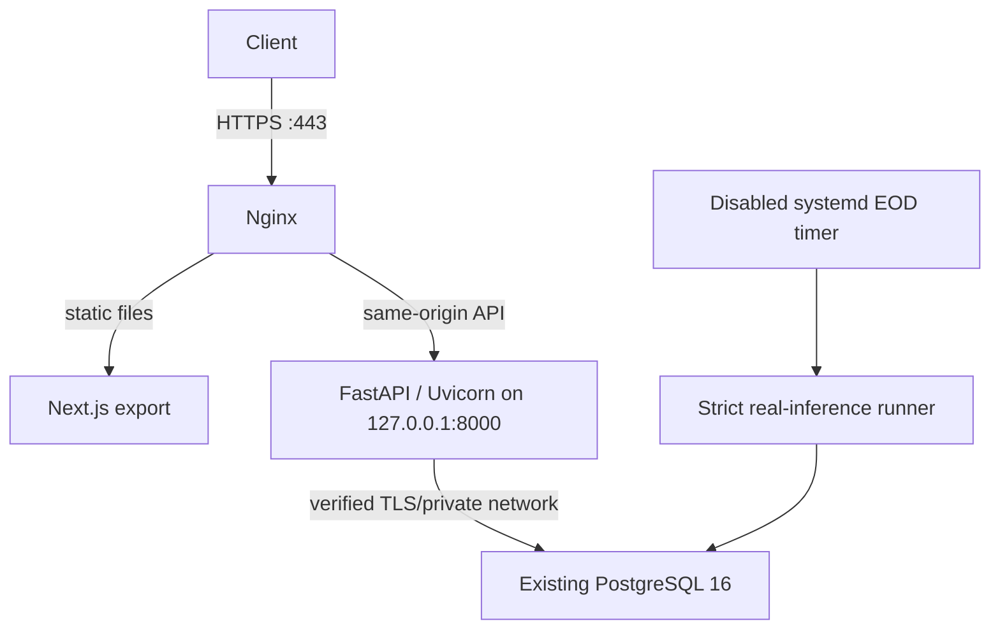

# PSE Pulse Application Architecture

PSE Pulse combines a statically exported Next.js interface with a Python FastAPI service and PostgreSQL persistence. This page describes the current Phase 4D runtime design; the owner reports that the existing Azure resources are deployed, while application deployment remains pending.

## Runtime boundaries

- The existing target reported for the project is an Ubuntu 24.04 `Standard_B2als_v2` VM and private PostgreSQL 16 `Standard_B1ms` in East Asia.
- Nginx is the only intended public application listener. It serves static files and proxies API traffic to loopback. The backend and database ports are not public application endpoints.
- The frontend is built on a separate workstation or CI runner. Node.js is not needed on the VM.
- The API and production inference runner use separate Python environments. This keeps scientific and LSTM packages out of the API-only process environment.
- PostgreSQL connections require TLS hostname verification and private DNS. Secrets come from root-controlled runtime configuration and are never stored in the repository.
- Alembic owns schema changes. App startup does not create or migrate the schema.

## Forecasting and market data

Production market data requires an owner-reviewed PSE calendar, official source files, and hash/provenance manifests. The EOD runner fails closed when a source is absent, malformed, stale, or incomplete. It records pending source state for a valid session with no staged source.

Real forecasts require the approved immutable model bundle and exactly one previously activated artifact for each active company/model pair. The EOD process never activates artifacts and never substitutes demo forecasts. Artifact activation, test inference, first persistence, and scheduled inference are separately gated.

## Operations

systemd runs API and scheduled work as the unprivileged `psepulse` user. Liveness is independent of database readiness; readiness returns a generic status without credentials or raw DB errors. Nginx requires a trusted IP certificate, but ACME issuance/renewal remains unvalidated. Both production timers remain disabled until their own acceptance checks.

Personal out-of-pocket spending is limited to USD 0. The USD 100 student credit is owner-reported and must be rechecked before any live operation. No new Azure resources or paid services are part of the runtime plan.

See [Azure production architecture](azure-production-architecture.md), [deployment runbook](azure-deployment.md), and [Phase 4D.1 status](../PHASE4D_IMPLEMENTATION_PREPARATION.md).
